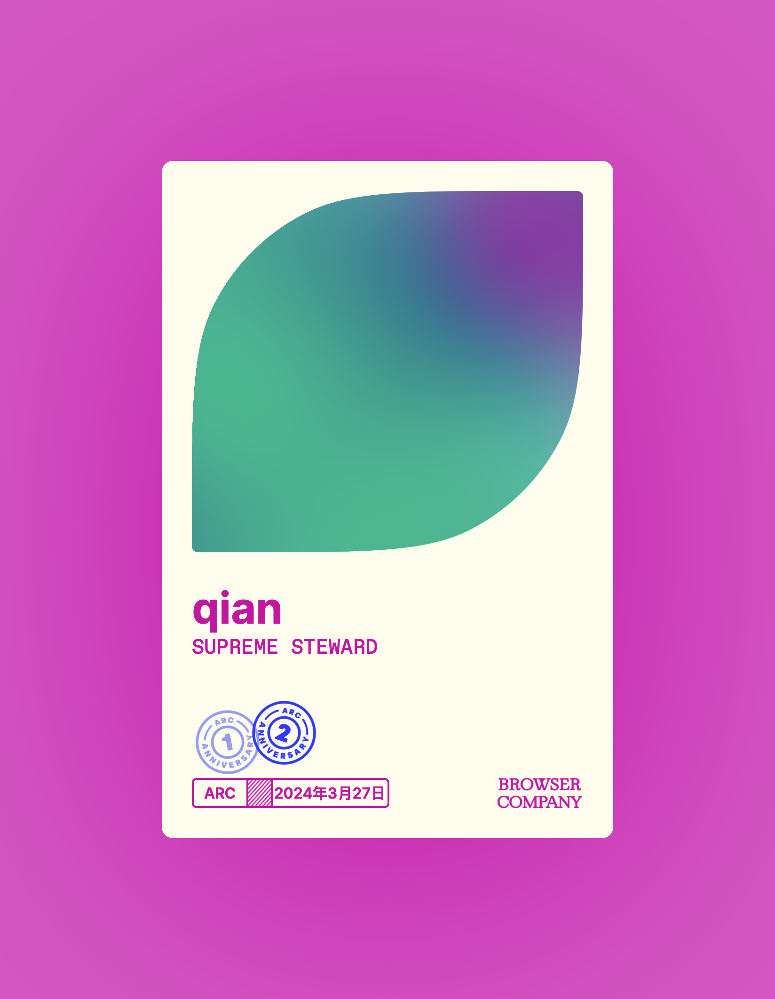
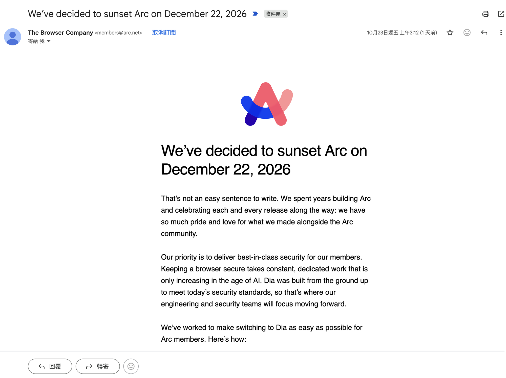

The Browser Company 在 2026 年 10 月 22 日宣布，Arc 會在 **2026 年 12 月 22 日**正式關閉。從 2025 年 5 月 Arc 進入維護模式、9 月被 Atlassian 收購之後，其實就有預感會走到這一步，只是真的發生了還是有點捨不得

這是我的 Arc 身份卡，從 2024 年 3 月 27 日開始用，拿到了一週年和兩週年的徽章，最後停在 Supreme Steward。用了兩年多，側邊欄分頁、Spaces、Peek 這些設計已經很難回去用傳統瀏覽器了，我的需求跟習慣基本上只有 Arc 這種的模式才有辦法滿足了，簡單來說就是被慣壞了

## Arc 關閉時程

10 月 23 日也收到了官方寄來的通知信

| 日期 | 會發生什麼事 |
| --- | --- |
| 2026/10/22 | 宣布關閉，同時停止建立新帳號 |
| 2026/11/23 | Arc Search（iOS / Android）移除 AI 功能（Browse for Me），停用登入與同步，只剩本機瀏覽 |
| 2026/12/22 | Mac / Windows 版正式關閉，帳號停用，個人資料會在 30 天內刪除 |

官方給的理由是安全性：在 AI 時代要維持一個瀏覽器的安全需要持續投入，而 Dia 是從頭照著現在的安全標準打造的，所以工程和資安資源都會集中在 Dia。官方的建議是直接搬到 Dia，密碼、書籤、擴充功能、歷史紀錄都能轉過去，Spaces 會變成 Profiles，Folders 變成 Pinned Tab Groups

至於大家一直在問的開源，CEO Josh Miller 之前就說過，Arc 沒辦法開源，因為它和 Dia 共用的 Arc Development Kit（ADK）是公司的核心價值

不過 Dia 主打的是 AI，跟我喜歡 Arc 的地方不太一樣。我平常其實幾乎很少用到瀏覽器裡的 AI 功能，在 Arc 上也是一樣，我在意的一直是側邊欄、Spaces 這些操作方式，所以我決定往開源的方向找

## 我的選擇：Zen Browser

[Zen Browser](https://zen-browser.app/) 是基於 Firefox（Gecko 引擎）的開源瀏覽器，2024 年 7 月首次發布，用 MPL 2.0 授權，支援 macOS、Windows、Linux

幾個跟 Arc 很像的功能：

- **垂直分頁側邊欄**：可以放左邊或右邊
- **Workspaces**：在同一個視窗裡依主題或專案分開分頁，對應 Arc 的 Spaces
- **Essentials 與分頁資料夾**：固定常用網站，資料夾可以巢狀
- **Split View**：多個分頁並排顯示
- **Glance**：點連結先用浮動視窗預覽，很像 Arc 的 Peek
- **Compact Mode**：自動隱藏側邊欄，畫面更大
- **Zen Mods**：社群做的主題和介面調整

因為是 Firefox 核心，可以直接用 Firefox 的擴充功能和 Mozilla 帳號同步

選它的原因很簡單：開源、跨平台、社群活躍，就算哪天團隊不做了，程式碼也還在，不會再遇到 Arc 這種說關就關的情況。比較需要注意的是它目前還標示為 Beta（寫這篇時最新是 1.23.4b），Arc 匯入功能官方也還在做，現在要搬 Spaces 和釘選分頁，可以先用社群做的轉移工具

## 持續關注的 Arc 平替

另外還有兩個看起來跟 Arc 很像的新瀏覽器，之後也會持續關注，但目前使用人數都偏少，用起來怕怕的也感覺還不是很穩定

### Ardia

[Ardia](https://ardia.dev/) 想做的是「Arc 的側邊欄設計＋ Dia 的精緻度」，用的是 Chromium 核心

- 只支援 macOS 14 以上的 Apple Silicon Mac
- 網址列整合進側邊欄，有 ⌘L 指令列
- 最多 3 個窗格並排或上下排列
- 切換分頁時影片會自動子母畫面
- 多個 Profile，各自分開登入、歷史和擴充功能
- 內建完整版 uBlock Origin（不是 Lite）
- 書籤和設定用 iCloud 端對端加密同步
- 支援 Chrome Web Store 擴充功能
- 可以匯入 Arc 的 Spaces 和釘選分頁

免費、GPL-3.0 開源，目前版本還在 0.2.x，屬於很早期的專案

### Crest

[Crest](https://crestbrowser.com/) 直接把自己定位成 Arc 的精神續作，Spaces、側邊欄、Peek、Split View 都有

- 支援 Mac（Apple Silicon）、iPad、iPhone，是這三個裡面唯一有行動版的
- 以 Chromium 為主，Mac 上可以針對個別網站改用 WebKit
- 可以替不同 Space 設定側邊欄主題和擴充功能
- 私密 Space，可以加上生物辨識鎖
- 內建內容阻擋，或改用 uBlock Origin Lite
- 指令面板、iCloud 同步
- 可以直接匯入 Arc 的 Spaces、分頁、資料夾和設定

免費、MPL 2.0 開源，目前是 Early Access，官方也有寫安全性還沒經過獨立稽核

## 平替們的簡單比較

|  | Zen Browser | Ardia | Crest |
| --- | --- | --- | --- |
| 核心 | Firefox（Gecko） | Chromium | Chromium（Mac 可選 WebKit） |
| 平台 | macOS / Windows / Linux | macOS（Apple Silicon） | Mac / iPad / iPhone |
| 授權 | MPL 2.0 | GPL-3.0 | MPL 2.0 |
| 狀態 | Beta | 早期（0.2.x） | Early Access |
| 擴充功能 | Firefox 擴充功能 | Chrome Web Store | 支援，可依 Space 分開 |
| Arc 匯入 | 官方開發中，可用社群工具 | 支援 | 支援 |

## 最後

Arc 讓我重新思考瀏覽器可以長什麼樣子，謝謝 The Browser Company 做出這麼有趣的產品。接下來先把主力搬到 Zen，Ardia 和 Crest 也會繼續追，等它們更成熟再回來寫一篇使用心得

如果你知道其他類似 Arc 的瀏覽器，歡迎在底下留言補充，或直接跟我聯絡，我會把它加進這篇文章，也會一起關注

## 參考資料

- [Arc browser sunsets December 22 as The Browser Company doubles down on Dia - TechCrunch](https://techcrunch.com/2026/10/22/arc-browser-sunsets-december-22-as-the-browser-company-doubles-down-on-dia/)
- [Arc browser gets a sunset date, and users have two months to move on - 9to5Mac](https://9to5mac.com/2026/10/22/arc-browser-gets-a-sunset-date-and-users-have-two-months-to-move-on/)
- [Import Arc browser data to Zen browser - GitHub Discussion](https://github.com/zen-browser/desktop/discussions/8967)
